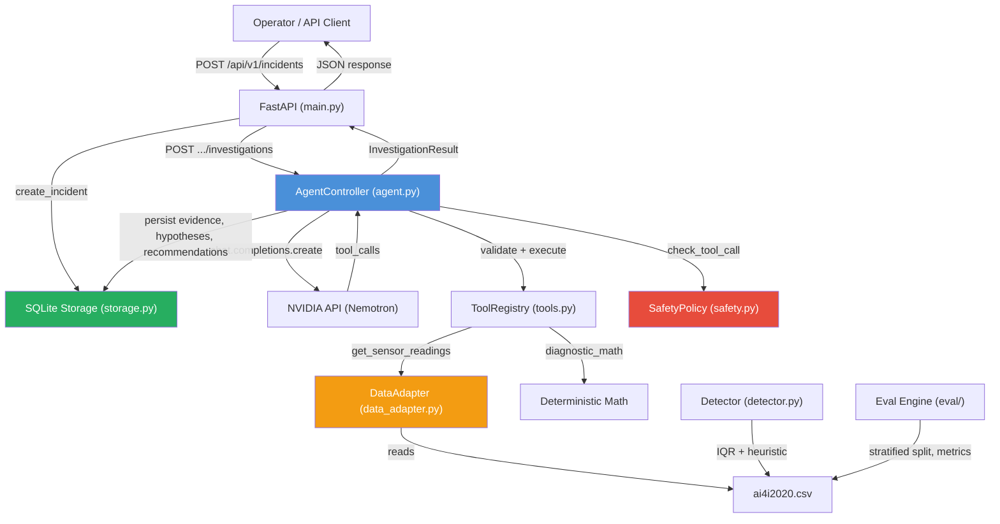
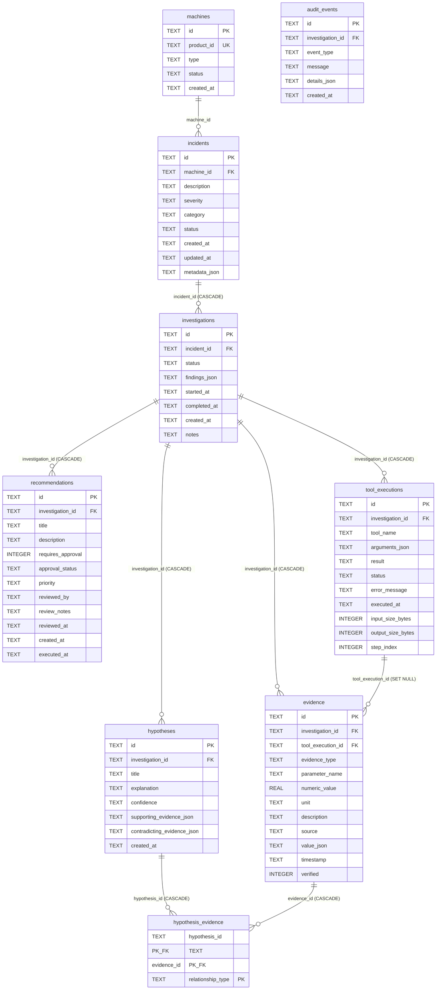

# PlantPilot — Codebase Reference (GEMINI.md)

> **Purpose:** Persistent reference for AI-assisted development sessions. Consult this document first before inspecting source files. Last verified against the codebase on **2026-10-26**.

---

## 1. Project Overview

PlantPilot is an **evidence-first, human-supervised industrial operations AI copilot**. It investigates machine incidents using historical dataset evidence, structured tool calling via the NVIDIA API, and isolated evaluation. The system enforces that no diagnosis is produced without verified observations.

- **Framework:** FastAPI + Pydantic v2 + SQLite (`sqlite3`) + OpenAI SDK (pointed at NVIDIA `https://integrate.api.nvidia.com/v1`)
- **Dataset:** AI4I 2020 Predictive Maintenance (10,000 records)
- **LLM:** `nvidia/nemotron-3.5-super-vl-120b-a12b` (configurable)
- **Python:** ≥ 3.13
- **Package Manager:** `uv`
- **Status:** Backend stabilised (94 tests passing); frontend planned

---

## 2. Project Structure

```
PlantPilot/
├── backend/                          # All backend source, data, tests
│   ├── app/plantpilot/               # Main Python package
│   │   ├── __init__.py               # Package exports
│   │   ├── main.py                   # FastAPI application & routes
│   │   ├── agent.py                  # Agent controller (bounded investigation loop)
│   │   ├── config.py                 # Environment-based configuration
│   │   ├── schemas.py                # Pydantic data models
│   │   ├── storage.py                # SQLite persistence layer (859 lines)
│   │   ├── tools.py                  # Tool registry & handlers
│   │   ├── safety.py                 # Safety policy enforcement
│   │   ├── data_adapter.py           # CSV-backed sensor data adapter
│   │   ├── detector.py               # Multi-signal anomaly detector (IQR + heuristic)
│   │   └── eval/                     # Evaluation engine (isolated from agent)
│   │       ├── __init__.py
│   │       ├── split.py              # Reproducible stratified dataset split
│   │       ├── metrics.py            # Binary classification metrics
│   │       └── baseline.py           # Deterministic baseline predictor
│   ├── tests/                        # 94 automated tests
│   │   ├── conftest.py               # Global fixtures (state reset)
│   │   ├── test_agent.py             # Agent controller unit tests
│   │   ├── test_api.py               # FastAPI endpoint tests
│   │   ├── test_eval_engine.py       # Evaluation engine tests
│   │   ├── test_evidence_first.py    # Evidence-first workflow tests (largest)
│   │   ├── test_integration_e2e.py   # End-to-end integration tests
│   │   ├── test_safety.py            # Safety policy tests
│   │   ├── test_schemas.py           # Pydantic schema validation tests
│   │   ├── test_storage.py           # SQLite storage layer tests
│   │   └── test_tools.py            # Tool registry & handler tests
│   ├── data/                         # Persistent data (gitignored DB)
│   │   ├── plantpilot.db             # SQLite database
│   │   ├── ai4i2020.csv              # Dataset (also at backend root)
│   │   └── README.md                 # Data governance notes
│   ├── ai4i2020.csv                  # Dataset (fallback location)
│   ├── test_nemotron.py              # Standalone NVIDIA API integration script
│   ├── pyproject.toml                # Dependencies & config
│   ├── uv.lock                       # Lock file
│   ├── .env                          # Secrets (gitignored)
│   └── .env.example                  # Template with all env vars
├── docs/                             # Obsidian knowledge base
│   ├── Architecture/ARCHITECTURE.md
│   ├── Dashboard/PLANTpilot HQ.md
│   ├── Development/DEVELOPMENT.md
│   └── Experiments/EXPERIMENT & TEST RESULTS.md
├── frontend/                         # Planned operator dashboard (empty)
├── README.md                         # Project README
├── .gitignore                        # Git exclusions
└── GEMINI.md                         # This file
```

---

## 3. Architecture & Data Flow



### Investigation Lifecycle

1. **Incident created** via API → persisted with status `PENDING`
2. **Investigation started** → AgentController runs bounded loop (max 8 steps)
3. **Step 0:** `tool_choice="required"` forces the model to call a diagnostic tool
4. **Tool execution:** Validated by ToolRegistry → checked by SafetyPolicy → executed
5. **Evidence persisted** as `EvidenceType.OBSERVED` with `verified=True` only on successful execution
6. **Model reasons** over evidence → generates hypotheses and recommendations
7. **Completion rules:**
   - `COMPLETED` — tools executed + evidence gathered + reasoning provided
   - `INCOMPLETE` — no tools executed, max steps/calls exceeded, or provider failure
8. **Recommendations** always require human approval (`requires_approval=True`)

---

## 4. Key Modules

### 4.1 `config.py` — Configuration

| Variable | Default | Purpose |
|---|---|---|
| `NVIDIA_API_KEY` | *(required)* | NVIDIA API authentication |
| `NVIDIA_BASE_URL` | `https://integrate.api.nvidia.com/v1` | API endpoint |
| `PLANTPILOT_MODEL` | `nvidia/nemotron-3.5-super-vl-120b-a12b` | Model identifier |
| `PLANTPILOT_DATABASE_PATH` | `data/plantpilot.db` | SQLite path |
| `PLANTPILOT_MAX_STEPS` | `8` | Max agent loop iterations |
| `PLANTPILOT_MAX_TOOL_CALLS` | `20` | Max tool calls per investigation |
| `PLANTPILOT_MAX_INPUT_SIZE` | `8000` | Max input size (bytes) |
| `PLANTPILOT_MAX_OUTPUT_TOKENS` | `4000` | Max LLM output tokens |
| `PLANTPILOT_API_TIMEOUT_SECONDS` | `60.0` | API request timeout |
| `PLANTPILOT_TOOL_RESULT_MAX_BYTES` | `4000` | Tool result byte limit |
| `PLANTPILOT_TOOL_RESULT_MAX_CHARS` | `1200` | Tool result char limit |
| `PLANTPILOT_EVIDENCE_MAX_CHARS` | `2000` | Evidence description limit |
| `PLANTPILOT_EVIDENCE_MAX_BYTES` | `8000` | Evidence byte limit |
| `PLANTPILOT_MAX_MESSAGE_CHARS` | `12000` | Max message chars |

- Configuration is loaded once via `get_config()` (singleton pattern with `_config` module-level cache)
- `.env` is loaded via `python-dotenv`; process environment takes precedence
- `reset_config()` exists for test teardown

### 4.2 `schemas.py` — Data Models

All models use Pydantic v2 with `ConfigDict(populate_by_name=True)`.

| Model | Purpose | Key Fields |
|---|---|---|
| `Machine` / `MachineCreate` | Industrial asset registration | `id`, `product_id`, `type`, `status` |
| `Incident` / `IncidentCreate` | Operational incident | `description`, `severity`, `category`, `machine_id`, `metadata` |
| `Investigation` / `InvestigationCreate` | Investigation record | `incident_id`, `status`, `findings`, `evidence[]`, `hypotheses[]`, `tool_executions[]`, `recommendations[]` |
| `EvidenceItem` | Provenance-tracked observation | `evidence_type` (enum), `source`, `tool_execution_id` (FK), `parameter_name`, `numeric_value`, `unit`, `verified` |
| `Hypothesis` | Model-generated explanation | `title`, `explanation`, `confidence`, `supporting_evidence_ids[]`, `contradicting_evidence_ids[]` |
| `Recommendation` | Human-gated action proposal | `requires_approval` (always True), `approval_status`, `reviewed_by`, `review_notes`, `reviewed_at` |
| `ToolExecution` | Tool call audit record | `tool_name`, `arguments`, `result`, `status`, `step_index`, `input_size_bytes`, `output_size_bytes` |
| `InvestigationResult` | Agent return type | `investigation_id`, `status`, `evidence_ids[]`, `hypothesis_ids[]`, `recommendation_ids[]`, `steps_taken`, `completed` |

**Enums:**
- `Status`: `PENDING`, `IN_PROGRESS`, `COMPLETED`, `FAILED`, `INCOMPLETE`
- `EvidenceType`: `OBSERVED`, `DERIVED`, `HYPOTHESIS`, `SIMULATED`
- `ApprovalStatus`: `PENDING_APPROVAL`, `APPROVED`, `REJECTED`

### 4.3 `agent.py` — Agent Controller

- **Class:** `AgentController(db, tool_registry, safety_policy)`
- **Factory:** `create_agent_controller(db=None)` — uses defaults
- **Core method:** `investigate(investigation, incident) → InvestigationResult`

**Investigation Loop Mechanics:**
- Bounded to `max_steps` (default 8) iterations
- Step 0 forces `tool_choice="required"` to ensure evidence gathering
- Subsequent steps use `tool_choice="auto"`
- Tool calls are validated, safety-checked, then executed
- **Evidence-first rule:** If no tool executes successfully → `INCOMPLETE`
- **Retry:** Exactly 1 retry for transient `InternalServerError` (provider `500`), only in early steps with no tool calls yet
- On successful completion: auto-generates a `Recommendation` (pending approval) and `Hypothesis` linked to evidence

**Error Handling:**
- Invalid JSON arguments → `ToolExecution(status=FAILED)`, error appended
- Safety rejection → `ToolExecution(status=FAILED)`, error appended
- `ToolError` → `FAILED` execution, does NOT set `tools_executed=True`
- Max tool calls exceeded → `INCOMPLETE`
- Max steps exceeded → `INCOMPLETE`

### 4.4 `tools.py` — Tool Registry

**Registered Tools:**

| Tool | Handler | Risk | Description |
|---|---|---|---|
| `get_sensor_readings` | `_sensor_data_handler` | `NONE` | Retrieves historical observation from AI4I 2020 by numeric UDI |
| `diagnostic_math` | `_diagnostic_math_handler` | `NONE` | Computes summary stats (count, sum, mean, min, max, std_dev, variance) |

**`ToolRegistry` Features:**
- `validate_arguments()` — enforces JSON schema: required fields, type checks, `enum` constraints, `minItems`, `additionalProperties`, and input size limits
- `execute()` — validates then calls handler
- `to_openai_tools()` — exports as OpenAI-compatible tool definitions

**`_sensor_data_handler` Validation:**
- Rejects non-integer UDI, text/description passed as UDI, negative/zero UDI
- Maps `sensor_type` to agent-facing parameters
- Delegates to `data_adapter.get_sensor_readings()`

**`_diagnostic_math_handler` Validation:**
- Rejects empty `values` arrays
- Rejects boolean values in array
- Requires all values to be numeric (int or float)

### 4.5 `data_adapter.py` — Dataset Adapter

- **Source:** `ai4i2020.csv` (checks `data/` dir first, then backend root)
- **Agent-facing columns:** `air_temperature`, `process_temperature`, `rotational_speed`, `torque`, `tool_wear`
- **Quarantined labels:** `Machine failure`, `TWF`, `HDF`, `PWF`, `OSF`, `RNF` — **never exposed** to agent

**Key Functions:**
- `get_sensor_readings(station_id, parameter?, csv_path?)` — Returns measurements with units, provenance, and source metadata. Lookup by UDI (int) or Product ID (string).
- `get_evaluation_only(station_id, csv_path?)` — Separate function returning ground-truth labels. For evaluation engine only.
- `_load_csv(path)` — Validates CSV header and numeric columns

**Parameter Aliases:** `air_temp` → `air_temperature`, `speed`/`rpm` → `rotational_speed`, `wear` → `tool_wear`, etc.

### 4.6 `detector.py` — Anomaly Detector

- **Detection methods:**
  - **IQR-based:** Computes Q1/Q3/IQR bounds from training data; flags values outside `[Q1 - 1.5×IQR, Q3 + 1.5×IQR]`
  - **Heuristic rule:** `tool_wear > 200` (documented experimental heuristic, not validated industrial limit)
- **Multi-signal detection:** Flags when ≥ 2 parameters are anomalous
- **Functions:**
  - `fit_references(train_rows)` — Computes reference statistics from training split
  - `detect(row, references)` → `DetectorResult`
  - `compute_iqr_bounds(values)` → `(lower, upper)`
- **Does NOT use** ground-truth failure labels as inputs

### 4.7 `safety.py` — Safety Policy

- **`SafetyPolicy` class:** Pure Python gatekeeper, independent of LLM
- **Risk levels:** `NONE`, `LOW`, `MEDIUM`, `HIGH`, `CRITICAL`
- **Permitted risks:** Only `NONE` and `LOW` are auto-approved
- **`check_tool_call(name, args)`** — Rejects unregistered tools and tools above permitted risk
- **`check_recommendation(rec)`** — Enforces `requires_approval=True` and `PENDING_APPROVAL` status
- **Audit trail:** All decisions recorded in `_audit_events` list
- **`default_safety_policy()`** — Pre-registers both tools (`get_sensor_readings`, `diagnostic_math`) at `RiskLevel.NONE`

### 4.8 `storage.py` — SQLite Persistence

- **Database class:** Manages connection, schema, and all CRUD operations
- **Singleton:** `get_database()` / `reset_database()` for caching
- **FK enforcement:** `PRAGMA foreign_keys = ON`
- **Auto-migration:** `_migrate_columns()` adds missing columns to existing tables safely

**CRUD Operations:**
- Machines: `create_machine`, `get_machine`, `list_machines`
- Incidents: `create_incident`, `get_incident`, `list_incidents`
- Investigations: `create_investigation`, `get_investigation`, `update_investigation`
- Evidence: `save_evidence`, `_load_evidence`
- Hypotheses: `save_hypothesis`, `_load_hypotheses` (uses junction table `hypothesis_evidence`)
- Recommendations: `save_recommendation`, `review_recommendation`, `_load_recommendations`
- Tool Executions: `save_tool_execution`, `_load_tool_executions`
- Audit Events: `save_audit_event`

### 4.9 `eval/` — Evaluation Engine

Completely isolated from agent and investigation code.

- **`split.py`:** Reproducible stratified split (`seed=42`, 70/15/15 train/dev/eval). Asserts zero overlap between splits.
- **`metrics.py`:** `compute_metrics(predictions, actual)` → precision, recall, F1, confusion matrix
- **`baseline.py`:** `baseline_predict(rows)` — deterministic rule: `tool_wear > 200 → 1, else 0`. Reports `F1 = 0.177`.

---

## 5. API Endpoints

All endpoints are prefixed with `/api/v1/`.

| Method | Path | Request Body | Response | Description |
|---|---|---|---|---|
| `GET` | `/` | — | `{application, version, status}` | Root health check |
| `GET` | `/health` | `?check_provider=bool` | `{status, backend, provider?}` | Backend + optional provider health |
| `POST` | `/api/v1/incidents` | `IncidentCreate` | `Incident` (201) | Create incident |
| `GET` | `/api/v1/incidents` | `?limit=50&offset=0` | `List[Incident]` | List incidents (newest first) |
| `GET` | `/api/v1/incidents/{id}` | — | `Incident` | Get single incident |
| `POST` | `/api/v1/incidents/{id}/investigations` | `InvestigationCreate` | `InvestigationResult` | Start AI investigation (synchronous) |
| `GET` | `/api/v1/investigations/{id}` | — | `Investigation` | Get investigation with full details |
| `POST` | `/api/v1/machines` | `MachineCreate` | `Machine` (201) | Register machine |
| `GET` | `/api/v1/machines` | `?limit=50&offset=0` | `List[Machine]` | List machines |
| `GET` | `/api/v1/machines/{id}` | — | `Machine` | Get single machine |
| `POST` | `/api/v1/recommendations/{id}/review` | `RecommendationReviewRequest` | `Recommendation` | Operator approve/reject |

**Notable:**
- Investigation endpoint is **synchronous** — runs the entire agent loop before responding
- `incident_id` in path must match body in investigation creation
- Limit range for list endpoints: `1–200`
- `ConfigError` has a dedicated exception handler returning 500

---

## 6. Database Schema



**Indexes:** Created on `incidents(status)`, `incidents(machine_id)`, `investigations(incident_id)`, `evidence(investigation_id)`, `evidence(tool_execution_id)`, `hypotheses(investigation_id)`, `hypothesis_evidence(hypothesis_id)`, `hypothesis_evidence(evidence_id)`, `recommendations(investigation_id)`, `tool_executions(investigation_id)`.

**ID conventions:** `inc_<hex12>`, `inv_<hex12>`, `ev_<hex12>`, `hyp_<hex12>`, `rec_<hex12>`, `exec_<hex12>`, `evt_<hex12>`, `mach_<hex12>` — all UUID-based prefixed strings.

---

## 7. Setup & Development Commands

### Prerequisites
- Python ≥ 3.13
- `uv` package manager

### Installation
```bash
cd backend
uv sync    # Install dependencies from uv.lock
```

### Environment Setup
```bash
cp backend/.env.example backend/.env
# Edit .env and set NVIDIA_API_KEY
```

### Start Backend
```bash
cd backend
uv run uvicorn app.plantpilot.main:app --reload --port 8000
```

Alternative (as seen in running terminal):
```bash
cd backend
..\.venv\Scripts\python.exe -m uvicorn --app-dir app plantpilot.main:app --reload --port 8000
```

### Run Tests
```bash
cd backend
uv run pytest tests/ -v
```

### Run NVIDIA Integration Test (standalone)
```bash
cd backend
uv run python test_nemotron.py
```

---

## 8. Testing

### Test Suite Overview (94 tests)

| File | Tests | Category |
|---|---|---|
| `test_agent.py` | Agent controller unit tests | Mocked OpenAI client |
| `test_api.py` | FastAPI endpoint tests | HTTP-level testing |
| `test_eval_engine.py` | Evaluation engine | Split, metrics, baseline |
| `test_evidence_first.py` | Evidence-first workflow | Largest test file — workflow invariants |
| `test_integration_e2e.py` | E2E integration | Real CSV + real tools + real SQLite, mocked provider only |
| `test_safety.py` | Safety policy | Risk levels, tool permissions |
| `test_schemas.py` | Pydantic schemas | Validation, enums, field constraints |
| `test_storage.py` | SQLite storage | CRUD, migrations, FK enforcement |
| `test_tools.py` | Tool registry | Argument validation, execution, error handling |

### Test Fixtures
- **`conftest.py`:** Auto-use fixture `reset_state()` clears cached `_config` and `_db` singletons before/after each test
- Tests use `tmp_path` for isolated SQLite databases
- OpenAI client is **mocked** at the `client.chat.completions.create` boundary

### Running Subset
```bash
uv run pytest tests/test_tools.py -v          # Only tool tests
uv run pytest tests/ -k "test_evidence" -v    # Pattern match
```

---

## 9. Conventions & Patterns

### Naming
- **IDs:** Prefixed UUID hex fragments (`inc_`, `inv_`, `ev_`, `hyp_`, `rec_`, `exec_`, `evt_`, `mach_`)
- **Modules:** Lowercase snake_case filenames
- **Classes:** PascalCase (`AgentController`, `ToolRegistry`, `SafetyPolicy`)
- **Error classes:** Suffix with `Error` (`ToolError`, `ConfigError`, `AgentError`, `DatabaseError`, `DataAdapterError`)

### Architectural Decisions
1. **Evidence-first:** No investigation completes without at least one successful tool execution producing `OBSERVED` evidence
2. **Label quarantine:** Ground-truth failure labels (`Machine failure`, `TWF`, etc.) are strictly isolated from agent-facing interfaces; only accessible via `get_evaluation_only()`
3. **Safety is code, not LLM:** The `SafetyPolicy` is a Python gatekeeper — never asks the model whether an action is safe
4. **Human-in-the-loop:** All `Recommendation` objects require human approval; `requires_approval=True` and `approval_status=PENDING_APPROVAL` are enforced
5. **Bounded loops:** Step limit and tool call limit prevent infinite agent loops
6. **Audit everything:** Tool executions, errors, retries, and completion events are persisted as audit records
7. **Singleton caching:** `get_config()` and `get_database()` use module-level singletons with corresponding `reset_*()` for tests
8. **Provider-independent tools:** The `ToolRegistry` exports OpenAI format but is independent of the model provider

### Error Handling
- **Tool errors:** Caught and recorded as `ToolExecution(status=FAILED)` — investigation continues
- **API/provider errors:** Transient 500s get 1 retry; other errors break the loop
- **Config errors:** Raise `ConfigError`; caught by FastAPI exception handler
- **DB errors:** Raise `DatabaseError`

### Code Organization
- Every module has a docstring explaining purpose and boundaries
- JSON columns in SQLite suffixed with `_json` (e.g., `findings_json`, `metadata_json`, `arguments_json`)
- Datetime values stored as ISO 8601 strings in SQLite, parsed on read

---

## 10. Dataset: AI4I 2020

| Property | Value |
|---|---|
| Records | 10,000 |
| File | `backend/ai4i2020.csv` (also in `backend/data/`) |
| Source | AI4I 2020 Predictive Maintenance Dataset |

### Agent-Facing Columns (Measurements)

| Key | CSV Column | Unit |
|---|---|---|
| `air_temperature` | `Air temperature [K]` | K |
| `process_temperature` | `Process temperature [K]` | K |
| `rotational_speed` | `Rotational speed [rpm]` | rpm |
| `torque` | `Torque [Nm]` | Nm |
| `tool_wear` | `Tool wear [min]` | min |

### Evaluation-Only Columns (Ground Truth)

| Key | CSV Column | Values |
|---|---|---|
| `machine_failure` | `Machine failure` | 0/1 |
| `twf` | `TWF` (Tool Wear Failure) | 0/1 |
| `hdf` | `HDF` (Heat Dissipation Failure) | 0/1 |
| `pwf` | `PWF` (Power Failure) | 0/1 |
| `osf` | `OSF` (Overstrain Failure) | 0/1 |
| `rnf` | `RNF` (Random Failure) | 0/1 |

### Identifier Columns

| Column | Description |
|---|---|
| `UDI` | Unique Dataset Identifier (1-indexed integer) |
| `Product ID` | Product identifier string |
| `Type` | Quality type: `L`, `M`, or `H` |

### Evaluation Split
- **Method:** Stratified by `Machine failure` (0/1), `seed=42`
- **Proportions:** 70% train / 15% dev / 15% eval
- **Integrity:** Asserted zero UDI overlap between splits
- **Baseline F1:** `0.177` (rule: `tool_wear > 200 → failure`)

---

## 11. Known Issues & Technical Debt

### Provider Reliability
- Full live `COMPLETED` investigations require a stable NVIDIA API endpoint
- Intermittent provider `500` errors produce honest `INCOMPLETE` results (not manufactured successes)
- The system retries transient errors at most once in early steps

### Dataset Limitations
- Anomaly detector thresholds (IQR) are dataset-derived, not validated industrial limits
- The `tool_wear > 200` heuristic is documented as experimental, not a safety standard
- Dataset is reloaded per call in `data_adapter.py` (no in-memory caching)

### Architectural Gaps
- **No frontend:** `frontend/` directory is empty — operator dashboard is planned but unbuilt
- **No real-time data:** No simulator or real-time factory integration (historical CSV only)
- **No async investigations:** The investigation endpoint is synchronous; long-running investigations block the request
- **No authentication/authorization:** API endpoints have no auth layer
- **No rate limiting:** No request rate limiting on API endpoints

### Code Quality Items
- `test_nemotron.py` is at the backend root level (not in `tests/`) — standalone integration script
- `AGENT_PARAMS` is duplicated in both `tools.py` (line 20) and `data_adapter.py` (line 23)
- The `hypothesis_evidence` junction table coexists with JSON columns (`supporting_evidence_json`, `contradicting_evidence_json`) in the `hypotheses` table — loading falls back to JSON when junction table has no rows
- `storage.py` is the largest module (859 lines) and could benefit from splitting into sub-modules
- Some test files include `sys.path.insert(0, "app")` — possibly unnecessary given `pythonpath` in pytest config

### Missing Features (from Roadmap)
- [ ] Build operator dashboard (`frontend/`)
- [ ] Prepare final hackathon presentation
- [ ] Dataset caching in data adapter
- [ ] Async investigation support

---

## 12. Quick Reference for Common Tasks

### Adding a New Tool
1. Write handler function `_my_handler(arguments: Dict) → Any` in `tools.py`
2. Register in `_build_default_registry()` with `Tool(name=..., handler=..., argument_schema=..., risk_level=...)`
3. Register in `default_safety_policy()` in `safety.py` with matching `ToolRisk`
4. Add tests in `tests/test_tools.py`

### Adding a New API Endpoint
1. Add route in `main.py`
2. Add Pydantic schemas in `schemas.py` if needed
3. Add storage methods in `storage.py` if needed
4. Add tests in `tests/test_api.py`

### Modifying the Database Schema
1. Add columns to the `CREATE TABLE` statement in `storage.py` `_initialize_schema()`
2. Add migration entry in `_migrate_columns()` for backward compatibility
3. Update corresponding Pydantic models in `schemas.py`
4. Update CRUD methods in `storage.py`
5. Add/update tests in `tests/test_storage.py`

### Running a Single Investigation (via API)
```bash
# 1. Create an incident
curl -X POST http://localhost:8000/api/v1/incidents \
  -H "Content-Type: application/json" \
  -d '{"description": "High tool wear on UDI 1", "severity": "high"}'

# 2. Start investigation (use incident_id from response)
curl -X POST http://localhost:8000/api/v1/incidents/{incident_id}/investigations \
  -H "Content-Type: application/json" \
  -d '{"incident_id": "{incident_id}"}'
```

---

## 13. Verification Summary

| Area | Verified |
|---|---|
| Project structure & file paths | ✅ All paths match filesystem |
| Dependencies in `pyproject.toml` | ✅ fastapi, openai, pydantic, pytest, python-dotenv, uvicorn |
| Environment variables in `.env.example` | ✅ All documented |
| API endpoints in `main.py` | ✅ 11 endpoints verified |
| Database schema in `storage.py` | ✅ 9 tables, indexes, FK constraints |
| Tool registry (`get_sensor_readings`, `diagnostic_math`) | ✅ Both registered with schemas |
| Safety policy (risk levels, approval enforcement) | ✅ Both tools at `NONE` risk |
| Evidence-first enforcement in `agent.py` | ✅ `tool_choice="required"` on step 0, `INCOMPLETE` without evidence |
| Label quarantine in `data_adapter.py` | ✅ `get_sensor_readings` excludes failure labels |
| Eval engine isolation | ✅ Separate `eval/` module, stratified split, baseline F1=0.177 |
| Test suite structure | ✅ 10 test files, conftest with auto-reset fixtures |
| Documentation in `docs/` | ✅ Architecture, Dashboard, Development, Experiments |
| Frontend status | ✅ Empty directory (planned) |
