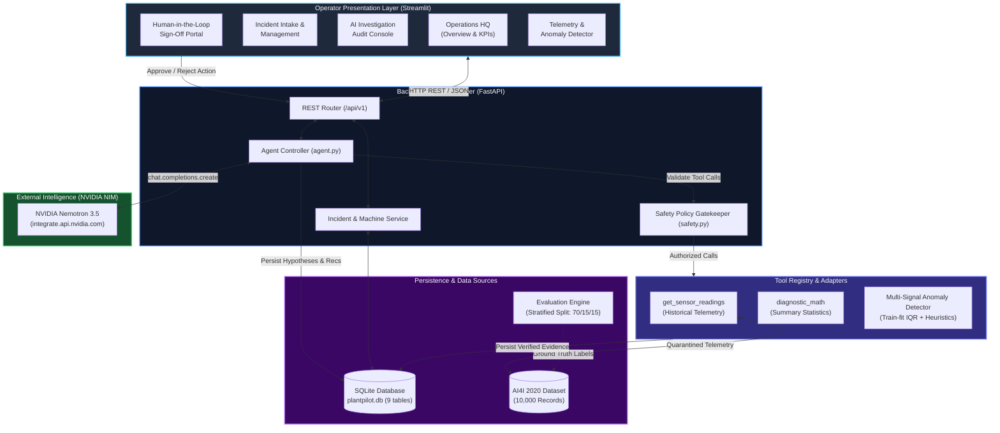

# PlantPilot 🏭 — Evidence-First Industrial Operations AI Copilot

[](backend/tests)
[](https://www.python.org/)
[](https://fastapi.tiangolo.com/)
[](https://streamlit.io/)
[](https://build.nvidia.com/)
[](https://sqlite.org/)
[](docs/Architecture/ARCHITECTURE.md)

> **PlantPilot** is a human-supervised, evidence-first industrial operations AI copilot. It investigates equipment anomalies, queries historical sensor telemetry through structured tool calling, separates empirical facts from probabilistic hypotheses, and enforces human sign-off on all operational recommendations.

---

## 📑 Table of Contents

- [Executive Overview](#-executive-overview)
- [Core Invariants & Safety Guardrails](#-core-invariants--safety-guardrails)
- [System Architecture & Data Flow](#-system-architecture--data-flow)
- [Project Directory Layout](#-project-directory-layout)
- [Knowledge Base & Docs Interconnection](#-knowledge-base--docs-interconnection)
- [Operator Dashboard (Streamlit Frontend)](#-operator-dashboard-streamlit-frontend)
- [FastAPI Backend & API Endpoints](#-fastapi-backend--api-endpoints)
- [Dataset & Evaluation Engine](#-dataset--evaluation-engine)
- [Quickstart Guide](#-quickstart-guide)
- [Automated Test Suite (183 Tests)](#-automated-test-suite-183-tests)
- [Technical Conventions & Design Decisions](#-technical-conventions--design-decisions)
- [Limitations & Honest Reporting](#-limitations--honest-reporting)

---

## 🌟 Executive Overview

In continuous manufacturing and industrial plants, unexplained equipment failures lead to millions in downtime. Traditional generative AI copilots often suffer from **hallucinated sensor values**, unverified diagnostic claims, or unmonitored command execution.

**PlantPilot solves this with non-negotiable principles:**

1. **Evidence-First Investigation**: The LLM agent controller cannot complete an incident diagnosis without successfully executing diagnostic tools against real historical telemetry and persisting verified observations (`EvidenceType.OBSERVED`, `verified=True`).
2. **Strict Ground-Truth Quarantine**: The AI model is strictly quarantined from ground-truth machine failure flags (`Machine failure`, `TWF`, `HDF`, `PWF`, `OSF`, `RNF`). The agent reasons solely from raw physical observations (`air_temp`, `process_temp`, `speed`, `torque`, `tool_wear`). Ground truth is exclusively reserved for the isolated evaluation engine.
3. **Deterministic Safety Policy Gatekeeper**: A pure Python safety layer intercepts every tool call and evaluates risk level (`NONE` to `CRITICAL`). All operational recommendations permanently mandate human approval (`requires_approval=True`, `status=PENDING_APPROVAL`).
4. **Proof-or-Refuse Diagnosis & Self-Auditing**: Deterministic validators assess evidence sufficiency, reject diagnoses based on contradictory evidence or ambiguous root causes, and audit investigation reports directly against SQLite telemetry logs.
5. **Modular Workforce Intelligence**: Role and certification-based clearance gating (`L1`-`L4`), shift coverage verification, maintenance work orders requiring verified inspector sign-off, and incident correlation.

---

## 🛡️ Core Invariants & Safety Guardrails

| Invariant | Implementation Mechanism | Enforcement |
|:---|:---|:---|
| **No Ghost Evidence** | `ToolRegistry.validate_arguments` & `data_adapter.py` | Schema-validated types; invalid UDI or parameter descriptions are rejected prior to execution. |
| **Forced Diagnostic Tool Call** | `agent.py` bounded loop (Step 0) | Uses `tool_choice="required"` on initial reasoning step to enforce empirical investigation before narrative generation. |
| **Tool Call Deduplication** | `agent.py` `InvestigationState` | Deduplicates identical tool calls within reasoning iterations to protect execution budget and provider tokens. |
| **Proof-or-Refuse Gating** | `diagnostics.py` `proof_or_refuse_diagnosis()` | Refuses diagnosis with candidate next tests if observations are insufficient, unverified, or contradictory. |
| **Report Claims Grounding** | `diagnostics.py` `audit_investigation_record()` | Audits report findings against actual DB telemetry; flags hallucinated values and claims citing failed tools as success. |
| **Workforce Clearance Gating** | `workforce/registry.py` & `safety.py` | Validates worker certification expiry and clearance (`L1`-`L4`) before allowing critical operational or maintenance actions. |
| **Label Quarantine** | `data_adapter.get_sensor_readings()` | Failure labels are dropped from agent-facing payloads. Ground truth is accessible only via `data_adapter.get_evaluation_only()`. |
| **Human Sign-Off Gate** | `safety.py` + `schemas.py` | Recommendations cannot be auto-executed. Operators must submit digital approvals via `POST /api/v1/recommendations/{id}/review`. |
| **Bounded Execution Loop** | `config.py` limits | Max 8 reasoning steps, max 20 tool calls, max 1 retry for qualifying transient provider `500` errors. |

---

## 🏗️ System Architecture & Data Flow



---

## 📁 Project Directory Layout

```text
PlantPilot/
├── backend/                              # Complete backend source, database & test suite
│   ├── app/plantpilot/                   # Core Python application package
│   │   ├── __init__.py                   # Package exports
│   │   ├── main.py                       # FastAPI application & REST endpoint routes
│   │   ├── agent.py                      # Bounded AI agent controller & state tracking loop
│   │   ├── config.py                     # Environment configuration & singleton loader
│   │   ├── schemas.py                    # Pydantic v2 data models, enums & validators
│   │   ├── storage.py                    # SQLite persistence layer (CRUD, schema & migrations)
│   │   ├── tools.py                      # Tool registry, schemas & deterministic tool handlers
│   │   ├── safety.py                     # Python safety policy gatekeeper & risk assessment
│   │   ├── data_adapter.py               # AI4I 2020 dataset adapter with label quarantine
│   │   ├── detector.py                   # Multi-signal anomaly detector (train-fit IQR + heuristics)
│   │   ├── detection.py                  # Supervised ML failure risk inference models
│   │   ├── digital_twin.py               # Digital twin store & isolated what-if simulation records
│   │   ├── diagnostics.py                # Proof-or-refuse validator, self-auditing & next-best-test engine
│   │   ├── workforce.py                  # Backward-compatible workforce facade
│   │   ├── workforce/                    # Modular Workforce Intelligence Subsystem
│   │   │   ├── __init__.py               # Subsystem package exports
│   │   │   ├── models.py                 # Pydantic models (Worker, Attendance, Shift, WorkOrder)
│   │   │   ├── registry.py               # Worker registration & L1-L4 clearance level gating
│   │   │   ├── attendance.py             # Clock-in/out, breaks & overnight shift hour calculation
│   │   │   ├── scheduling.py             # Shift schedules, coverage verification & handovers
│   │   │   ├── maintenance.py            # Work order lifecycle & inspector evidence verification
│   │   │   ├── analytics.py              # Rule-based operational anomaly & fatigue detection
│   │   │   ├── correlation.py            # Incident correlation across workers, maintenance & handovers
│   │   │   └── service.py               # Unified service orchestrator & SQLite migrations
│   │   └── eval/                         # Isolated evaluation engine
│   │       ├── __init__.py
│   │       ├── split.py                  # Stratified dataset splitting (seed=42, 70/15/15)
│   │       ├── metrics.py                # Binary classification metrics & confusion matrix
│   │       └── baseline.py               # Deterministic baseline predictor (F1 = 0.177)
│   ├── tests/                            # Comprehensive automated test suite (183 tests, 20 modules)
│   │   ├── conftest.py                   # Global pytest fixtures & singleton state resets
│   │   ├── test_agent.py                 # Agent controller logic & loop boundary tests
│   │   ├── test_api.py                   # FastAPI HTTP route & status code tests
│   │   ├── test_detection.py             # ML failure risk inference & normalization tests
│   │   ├── test_diagnostics.py           # Evidence sufficiency, report claims audit & test ranking
│   │   ├── test_digital_twin.py          # Digital twin store & isolation tests
│   │   ├── test_eval_engine.py           # Evaluation isolation & split validation tests
│   │   ├── test_evidence_first.py        # Evidence-first invariants & failure recovery tests
│   │   ├── test_integration_e2e.py       # End-to-end integration workflows with live CSV
│   │   ├── test_investigation_state.py   # In-memory investigation state & tool deduplication tests
│   │   ├── test_next_best_test.py        # Next-Best-Test ranking, cost/risk penalty & executable tools
│   │   ├── test_proof_or_refuse.py       # Strict proof-or-refuse validator tests
│   │   ├── test_report_auditing.py       # Self-auditing report grounding vs DB records & causality
│   │   ├── test_safety.py                # Tool permission, risk grading & recommendation checks
│   │   ├── test_schemas.py               # Schema serialization, defaults & validation checks
│   │   ├── test_storage.py               # SQLite CRUD, FK cascades & junction table tests
│   │   ├── test_tools.py                 # Tool registration, arguments & math calculation tests
│   │   ├── test_workforce.py             # Legacy workforce store facade tests
│   │   ├── test_workforce_api.py         # Workforce REST API endpoint tests
│   │   ├── test_workforce_integration.py # Incident correlation & clearance enforcement tests
│   │   └── test_workforce_modular.py     # Modular workforce subsystem unit tests
│   ├── data/                             # Persistent runtime data
│   │   ├── plantpilot.db                 # SQLite database file
│   │   └── README.md                     # Data governance notes
│   ├── ai4i2020.csv                      # AI4I 2020 Predictive Maintenance dataset (10,000 rows)
│   ├── pyproject.toml                    # Python package dependencies & pytest configurations
│   ├── .env                              # Environment secrets (gitignored)
│   └── .env.example                      # Template for all environment variables
├── docs/                                 # Obsidian-compatible technical documentation base
│   ├── Architecture/
│   │   └── ARCHITECTURE.md               # Detailed architectural specs, component duties & data flow
│   ├── Dashboard/
│   │   └── PLANTpilot HQ.md              # Project status, mission statement & development roadmaps
│   ├── Development/
│   │   └── DEVELOPMENT.md                # Chronological engineering logs, refactoring & milestones
│   └── Experiments/
│       └── EXPERIMENT & TEST RESULTS.md  # Experiment logs (001-003), audit metrics & benchmarks
├── frontend/                             # Streamlit Operator Dashboard (UI)
│   ├── app.py                            # Streamlit entry point, routing & sidebar navigation
│   ├── api_client.py                     # Resilient HTTP client for FastAPI backend integration
│   ├── styles.css                        # Modern industrial dark-mode stylesheet
│   └── views/                            # 8 dedicated operational views
│       ├── overview.py                   # Operations HQ: real-time KPIs, active incidents & stats
│       ├── incidents.py                  # Incident registration, filtering & status tracking
│       ├── investigations.py             # AI Investigation Console: step trace, evidence & hypotheses
│       ├── approvals.py                  # Human Operator Sign-Off: recommendation review portal
│       ├── fleet.py                      # Fleet asset registry & machine profile management
│       ├── detector_view.py              # Telemetry explorer & real-time IQR anomaly inspection
│       ├── eval_view.py                  # Stratified split analytics & baseline evaluation benchmarks
│       └── system_health.py              # Live health checks, test suite status & database metrics
├── GEMINI.md                             # AI context reference & complete architectural specification
├── README.md                             # This file
└── .gitignore                            # Git exclusion rules
```

---

## 📚 Knowledge Base & Docs Interconnection

The project contains a comprehensive documentation knowledge base located in [`docs/`](file:///c:/Warning/hackathon/PlantPilot/docs), fully formatted for [Obsidian](https://obsidian.md/) and GitHub Markdown.

```
docs/
├── Architecture/
│   └── ARCHITECTURE.md          ─── Component boundaries, data flow pipelines & decoupled design
├── Dashboard/
│   └── PLANTpilot HQ.md         ─── High-level mission, phase status, development milestones
├── Development/
│   └── DEVELOPMENT.md           ─── Engineering changelog, empty-input debugging, decoupling history
└── Experiments/
    └── EXPERIMENT & TEST RESULTS.md  ─── Controlled experiments (001-003) & benchmark evaluation metrics
```

### Detailed Document Directory

| Document | Primary Focus | Key Takeaways & Reference Links |
|:---|:---|:---|
| [`docs/Architecture/ARCHITECTURE.md`](file:///c:/Warning/hackathon/PlantPilot/docs/Architecture/ARCHITECTURE.md) | **System Architecture & Data Pipelines** | Documents the 6 core components (Data Adapter, Detector, Agent, Safety, Storage, UI), the end-to-end data flow pipeline, and the decoupled architecture principle ensuring model independence from data sources. |
| [`docs/Dashboard/PLANTpilot HQ.md`](file:///c:/Warning/hackathon/PlantPilot/docs/Dashboard/PLANTpilot%20HQ.md) | **Project Mission & Roadmap** | High-level operations cockpit tracking completed milestones (API, evidence-first agent, tool calling, 100 tests, decoupled frontend) and core project principles. |
| [`docs/Development/DEVELOPMENT.md`](file:///c:/Warning/hackathon/PlantPilot/docs/Development/DEVELOPMENT.md) | **Engineering Logs & Problem Resolution** | In-depth retrospective covering early failure investigations (empty list handling in `diagnostic_math`), decoupling milestones, and test suite growth from 64 to 100 passing tests. |
| [`docs/Experiments/EXPERIMENT & TEST RESULTS.md`](file:///c:/Warning/hackathon/PlantPilot/docs/Experiments/EXPERIMENT%20&%20TEST%20RESULTS.md) | **Scientific Validation & Experiments** | Detailed documentation of **Experiment 001** (unsubstantiated conclusions in naive loops), **Experiment 002** (input validation failure enforcement), and **Experiment 003** (verified evidence-first investigation completing with 100% test integrity). |
| [`GEMINI.md`](file:///c:/Warning/hackathon/PlantPilot/GEMINI.md) | **Codebase Reference (AI Context Anchor)** | 650+ line technical specification for AI pair programming sessions. Covers configuration tables, Pydantic schemas, database ERD, tool signatures, safety policies, and troubleshooting. |

---

## 🖥️ Operator Dashboard (Streamlit Frontend)

The presentation layer is implemented as an industrial-grade Streamlit application (`frontend/app.py`), styled with a sleek dark-mode aesthetic (`frontend/styles.css`).

```
┌────────────────────────────────────────────────────────────────────────┐
│  PlantPilot Operator Dashboard                                         │
│  [Operations HQ]  [Incidents]  [Investigations]  [Operator Sign-Off]   │
├────────────────────────────────┬───────────────────────────────────────┤
│ Active Incidents: 4            │ Equipment Telemetry (UDI: 1042)       │
│ Pending Approvals: 2           │ Air Temp: 300.1 K | Speed: 1420 RPM   │
│ Monitored Machines: 12         │ Status: Torque Spike Detected [IQR]   │
├────────────────────────────────┴───────────────────────────────────────┤
│ AI Investigation Trace: inv_8f92a10b4c2e                               │
│  ├── [Step 0] Tool Call: get_sensor_readings(udi=1042) -> VERIFIED     │
│  ├── [Step 1] Tool Call: diagnostic_math(metric='torque') -> COMPUTED  │
│  ├── [Step 2] Hypothesis Generated: Bearing Friction (Confidence: 85%) │
│  └── [Step 3] Recommendation: Lubricate spindle bearing (PENDING_AUTH) │
└────────────────────────────────────────────────────────────────────────┘
```

### The 8 Dedicated Dashboard Views

1. **Operations HQ (`views/overview.py`)**: Real-time operational overview with metric cards for active machines, pending sign-offs, open incidents, and quick-action shortcuts.
2. **Incident Management (`views/incidents.py`)**: Full operational incident registry. Filter by severity (`LOW`, `MEDIUM`, `HIGH`, `CRITICAL`), view status, and register new machine incidents with operational metadata.
3. **AI Investigation Center (`views/investigations.py`)**: Trigger synchronous AI agent investigations with a single click. Inspect step-by-step reasoning logs, verified observed evidence, model hypotheses, and supporting evidence links.
4. **Human Operator Sign-Off (`views/approvals.py`)**: Dedicated governance hub. Operators can review proposed recommendations, inspect rationale, and digitally approve or reject actions with operator identity and audit notes.
5. **Fleet & Asset Registry (`views/fleet.py`)**: Comprehensive catalog of plant machinery (Low, Medium, and High-variant milling/lathe equipment), operational status, and asset creation modal.
6. **Dataset & Anomaly Detector (`views/detector_view.py`)**: Direct telemetry inspector for the 10,000-row AI4I 2020 dataset. Features interactive anomaly detection calculating IQR deviation bounds across multi-signal sensor readings.
7. **Evaluation & Benchmarks (`views/eval_view.py`)**: Transparency dashboard presenting stratified dataset splits (70% train / 15% dev / 15% eval), deterministic baseline evaluation metrics (Precision, Recall, F1), and label quarantine verification.
8. **System Health & Tests (`views/system_health.py`)**: Real-time diagnostic panel displaying FastAPI backend status, NVIDIA LLM provider connectivity ping, database integrity statistics, and automated test execution status.

---

## ⚡ FastAPI Backend & API Endpoints

The backend is built with FastAPI and runs on ASGI server Uvicorn. All endpoints are fully validated using Pydantic v2 schemas and documented via OpenAPI Swagger UI (`/docs`).

| Method | Endpoint | Description | Status Code |
|:---|:---|:---|:---:|
| `GET` | `/` | Root application metadata & health status | `200` |
| `GET` | `/health` | Application health; optional `?check_provider=true` for NVIDIA API ping | `200` |
| `POST` | `/api/v1/incidents` | Register an industrial incident | `201` |
| `GET` | `/api/v1/incidents` | Paginated incident list (`?limit=50&offset=0`) | `200` |
| `GET` | `/api/v1/incidents/{id}` | Retrieve incident details and investigation status | `200` |
| `POST` | `/api/v1/incidents/{id}/investigations` | Launch synchronous AI agent investigation | `200` |
| `GET` | `/api/v1/investigations` | Paginated investigation list | `200` |
| `GET` | `/api/v1/investigations/{id}` | Full investigation trace (evidence, hypotheses, recommendations) | `200` |
| `POST` | `/api/v1/investigations/{id}/audit` | Audit investigation findings directly against DB records | `200` |
| `POST` | `/api/v1/machines` | Register an industrial asset/machine in fleet | `201` |
| `GET` | `/api/v1/machines` | Paginated machine registry list | `200` |
| `GET` | `/api/v1/machines/{id}` | Retrieve machine profile & operational status | `200` |
| `GET` | `/api/v1/recommendations` | Paginated operational recommendation list | `200` |
| `POST` | `/api/v1/recommendations/{id}/review` | Human operator sign-off (Approve / Reject) | `200` |
| `POST` | `/api/v1/twins` | Register digital twin asset | `201` |
| `GET` | `/api/v1/twins` | Paginated digital twin asset list | `200` |
| `GET` | `/api/v1/twins/{id}` | Retrieve digital twin status & latest telemetry snapshot | `200` |
| `GET` | `/api/v1/twins/{id}/history` | Retrieve digital twin telemetry history | `200` |
| `POST` | `/api/v1/twins/{id}/readings` | Push observed twin telemetry with auto-assessed ML risk | `201` |
| `POST` | `/api/v1/twins/{id}/simulate` | Run isolated what-if operational parameter simulation | `200` |
| `POST` | `/api/v1/predict-risk` | Standalone ML supervised failure risk prediction | `200` |
| `POST` | `/api/v1/diagnostics/assess` | Deterministic evidence sufficiency assessment | `200` |
| `POST` | `/api/v1/diagnostics/audit-report` | Audit claims in investigation diagnostic report | `200` |
| `POST` | `/api/v1/diagnostics/rank-tests` | Rank candidate physical & software diagnostic tests | `200` |
| `POST` | `/api/v1/diagnostics/proof-or-refuse` | Strict proof-or-refuse validator (rejects ungrounded diagnoses) | `200` |
| `POST` | `/api/v1/workforce/workers` | Register worker profile with clearance & qualifications | `201` |
| `GET` | `/api/v1/workforce/workers` | List registered workforce profiles | `200` |
| `GET` | `/api/v1/workforce/workers/{id}` | Retrieve worker profile & certification status | `200` |
| `POST` | `/api/v1/workforce/clock-in` | Clock in worker with shift & role metadata | `201` |
| `POST` | `/api/v1/workforce/clock-out` | Clock out worker with automatic break hour deductions | `200` |
| `GET` | `/api/v1/workforce/workers/{id}/attendance` | Retrieve worker attendance records | `200` |
| `POST` | `/api/v1/workforce/clearance-check` | Enforce L1-L4 operational & maintenance clearance | `200` |
| `POST` | `/api/v1/workforce/detect-anomalies` | Detect rule-based operational findings (fatigue/overtime) | `200` |
| `POST` | `/api/v1/workforce/model-review` | AI-assisted workforce review & shift recommendations | `200` |
| `POST` | `/api/v1/workforce/shifts/schedules` | Create planned shift schedule | `201` |
| `GET` | `/api/v1/workforce/shifts/schedules` | List planned shift schedules | `200` |
| `GET` | `/api/v1/workforce/shifts/schedules/{id}/coverage` | Verify staffing coverage vs active worker attendance | `200` |
| `POST` | `/api/v1/workforce/shifts/handovers` | Log shift handover notes and safety notices | `201` |
| `GET` | `/api/v1/workforce/shifts/handovers` | List shift handover logs | `200` |
| `POST` | `/api/v1/workforce/work-orders` | Create maintenance work order | `201` |
| `GET` | `/api/v1/workforce/work-orders` | List maintenance work orders | `200` |
| `GET` | `/api/v1/workforce/work-orders/{id}` | Retrieve maintenance work order by ID | `200` |
| `POST` | `/api/v1/workforce/work-orders/{id}/complete` | Complete work order requiring verified inspector sign-off | `200` |
| `POST` | `/api/v1/workforce/correlate` | Correlate incident with active workers & maintenance events | `200` |

---

## 📊 Dataset & Evaluation Engine

### AI4I 2020 Predictive Maintenance Dataset
The system operates against the **AI4I 2020 Predictive Maintenance Dataset** (`backend/ai4i2020.csv`), comprising 10,000 synthetic records reflecting real milling machine operations.

* **Agent-Facing Operational Telemetry:**
  * Air temperature $[K]$ (ambient temperature)
  * Process temperature $[K]$ (operating heat)
  * Rotational speed $[rpm]$ (calculated spindle speed)
  * Torque $[Nm]$ (resistance torque)
  * Tool wear $[min]$ (cumulative tool usage duration)
* **Quarantined Ground-Truth Failure Modes (Evaluation Only):**
  * `Machine failure` (General binary indicator)
  * `TWF` (Tool Wear Failure)
  * `HDF` (Heat Dissipation Failure)
  * `PWF` (Power Failure)
  * `OSF` (Overstrain Failure)
  * `RNF` (Random Failure)

### Rigorous Evaluation Split
Located in `backend/app/plantpilot/eval/`:
* **Stratified Split (`split.py`):** Fixed random seed (`seed=42`) creating reproducible splits:
  * **Train Split:** 7,000 records (70%) — used to fit IQR reference statistics.
  * **Dev Split:** 1,500 records (15%) — validation and threshold calibration.
  * **Eval Split:** 1,500 records (15%) — held-out benchmark evaluation.
  * *Zero record overlap strictly validated by automated tests.*
* **Deterministic Baseline (`baseline.py`):** Evaluates `tool_wear > 200 min` heuristic on held-out evaluation split, establishing an honest deterministic baseline:
  $$\text{Baseline F1} = 0.177 \quad (\text{Precision} = 0.108, \text{Recall} = 0.509)$$

---

## 🚀 Quickstart Guide

### Prerequisites
- Python $\ge$ 3.13
- A valid NVIDIA NIM API key (from [build.nvidia.com](https://build.nvidia.com/))

### 1. Clone & Set Up Virtual Environment

```bash
git clone https://github.com/akshat-vish/PLANTpilot.git
cd PLANTpilot

# Create virtual environment
python -m venv .venv

# Activate on Windows:
.venv\Scripts\activate
# Activate on Linux / macOS:
source .venv/bin/activate
```

### 2. Install Dependencies

```bash
# Install backend dependencies
cd backend
pip install -e .

# Install frontend dependencies
cd ../frontend
pip install streamlit requests
cd ..
```

*(Alternatively, if using `uv`: `uv sync` from backend).*

### 3. Configure Environment Variables

Create `backend/.env` from the provided example template:

```bash
cp backend/.env.example backend/.env
```

Open `backend/.env` and supply your credentials:
```ini
NVIDIA_API_KEY=nvapi-your-actual-api-key-here
NVIDIA_BASE_URL=https://integrate.api.nvidia.com/v1
PLANTPILOT_MODEL=nvidia/nemotron-3.5-super-vl-120b-a12b
PLANTPILOT_DATABASE_PATH=data/plantpilot.db
```

### 4. Start the Application

Open two terminal sessions:

**Terminal 1 — FastAPI Backend:**
```bash
cd backend
python -m uvicorn app.plantpilot.main:app --reload --port 8000
```
*API will be accessible at: `http://127.0.0.1:8000` (Interactive API docs at: `http://127.0.0.1:8000/docs`)*

**Terminal 2 — Streamlit Operator Dashboard:**
```bash
cd frontend
streamlit run app.py
```
*Operator Dashboard will launch automatically in your browser at: `http://localhost:8501`*

---

## 🧪 Automated Test Suite (183 Tests)

PlantPilot maintains a rigorous automated test suite with **183 passed tests (100% pass rate)** across 20 test modules. Tests cover schema validation, database foreign key constraints, safety policies, label quarantine, tool execution, investigation state tracking, proof-or-refuse validation, next-best-test ranking, and the modular workforce subsystem.

All tests run **100% deterministically without external API dependencies**.

### Running Tests

Execute all tests from the `backend/` directory using `uv`:

```bash
cd backend
uv run pytest tests/ -v
```

*(Or via standard pytest: `python -m pytest tests/ -v`).*

### Test Suite Structure

| Test File | Test Count | Focus Area |
|:---|:---:|:---|
| `test_evidence_first.py` | 21 | Evidence-first loop invariants, input rejection, fallback recovery |
| `test_storage.py` | 20 | SQLite schema integrity, FK cascades, junction tables, migrations |
| `test_tools.py` | 16 | Tool argument schema checks, OpenAI formatting, statistical math, handlers |
| `test_schemas.py` | 13 | Pydantic v2 data models, default values, serialization, validators |
| `test_api.py` | 21 | FastAPI HTTP endpoints, status codes, payload validation |
| `test_integration_e2e.py` | 11 | End-to-end pipeline with real dataset CSV and tool execution |
| `test_agent.py` | 9 | Bounded loop steps, tool call limits, provider failure handling |
| `test_workforce_modular.py` | 9 | Modular workforce (registry, attendance, overnight shifts, maintenance, analytics) |
| `test_detection.py` | 8 | Supervised ML failure risk inference (GBDT + RF) |
| `test_workforce.py` | 7 | Legacy workforce store facade, shift tracking, clearance gating |
| `test_eval_engine.py` | 6 | Stratified splits (70/15/15), label quarantine, baseline metrics |
| `test_safety.py` | 6 | Tool risk levels (`NONE` to `CRITICAL`), recommendation sign-off checks |
| `test_diagnostics.py` | 6 | Evidence sufficiency, report claim audits, next-test ranking |
| `test_workforce_api.py` | 6 | Workforce REST API endpoints (schedules, coverage, handovers, work orders) |
| `test_investigation_state.py` | 5 | In-memory investigation state tracking, budget limits, deduplication |
| `test_proof_or_refuse.py` | 5 | Strict proof-or-refuse validator, evidence sufficiency & contradictions |
| `test_digital_twin.py` | 5 | Digital twin store, telemetry ingestion, isolated simulation |
| `test_report_auditing.py` | 4 | Self-auditing report claims grounding vs DB records & causality |
| `test_next_best_test.py` | 3 | Next-Best-Test ranking, information gain, cost/risk penalty & executable tools |
| `test_workforce_integration.py` | 2 | Workforce incident correlation & clearance enforcement on critical actions |
| **Total** | **183** | **100% Passing in ~8.5 seconds** |

---

## 📐 Technical Conventions & Design Decisions

- **Deterministic ID Prefixes:** All database entities use prefixed 12-character hex UUIDs:
  - Incidents: `inc_<hex12>`
  - Investigations: `inv_<hex12>`
  - Evidence Items: `ev_<hex12>`
  - Hypotheses: `hyp_<hex12>`
  - Recommendations: `rec_<hex12>`
  - Tool Executions: `exec_<hex12>`
  - Machines: `mach_<hex12>`
  - Audit Events: `evt_<hex12>`
- **Decoupled Architecture:** The investigation engine is decoupled from the underlying data source or UI framework, enabling easy replacement of synthetic datasets with live OPC-UA or MQTT industrial telemetry streams.
- **Foreign Key Cascades:** SQLite database enforces `PRAGMA foreign_keys = ON`. Deleting an incident cascades to its investigations, evidence, hypotheses, and recommendations, preventing orphaned records.
- **Provider-Agnostic Tools:** The tool registry exports standard OpenAI-compatible function definitions, allowing seamless switching between NVIDIA NIM, OpenAI, or local Ollama / vLLM endpoints.

---

## ⚖️ Limitations & Honest Reporting

In alignment with our engineering principles:
1. **Model Provider Dependency:** A complete investigation requires an active connection to the NVIDIA NIM endpoint. If the upstream provider experiences intermittent 500 errors, the agent controller honestly flags the investigation as `INCOMPLETE` with audit records rather than hallucinating an ungrounded result.
2. **Anomaly Thresholds:** Anomaly detector thresholds are statistical derivations (IQR) fit on the AI4I training split combined with documented heuristics (`tool_wear > 200 min`). They are experimental demonstrations, not certified industrial safety limits.
3. **No Direct PLC Actuation:** PlantPilot intentionally does not interface directly with physical PLCs or machine actuators; all interventions require operator confirmation through the human sign-off portal.

---

## 👥 Contributors & Acknowledgments

- **Developed for:** Industrial Operations & Predictive Maintenance Hackathon
- **Team:** Akshat Vishwakarma & Contributors
- **Dataset:** AI4I 2020 Predictive Maintenance Dataset (Stephan Matzka, HTW Berlin / UCI ML Repository)
- **Model:** NVIDIA Nemotron-3.5 Super VL 120B (NVIDIA Build API)

---

<div align="center">
  <sub>Built with engineering discipline, evidence-first rigor, and safety-critical human supervision.</sub>
</div>
