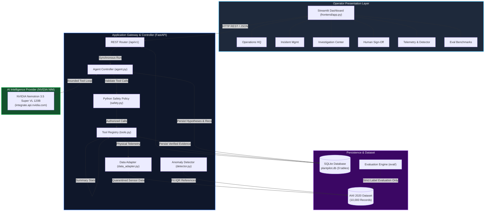
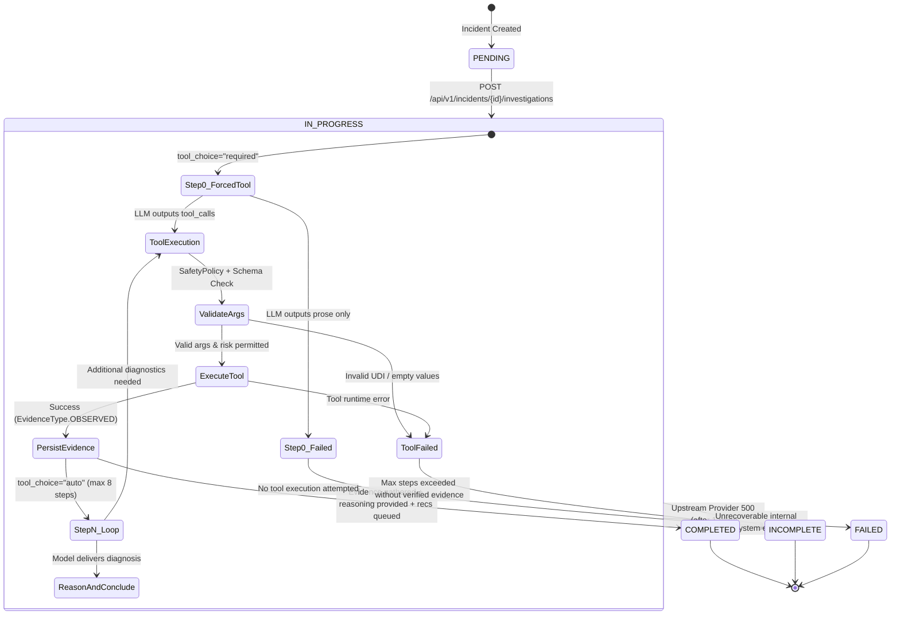
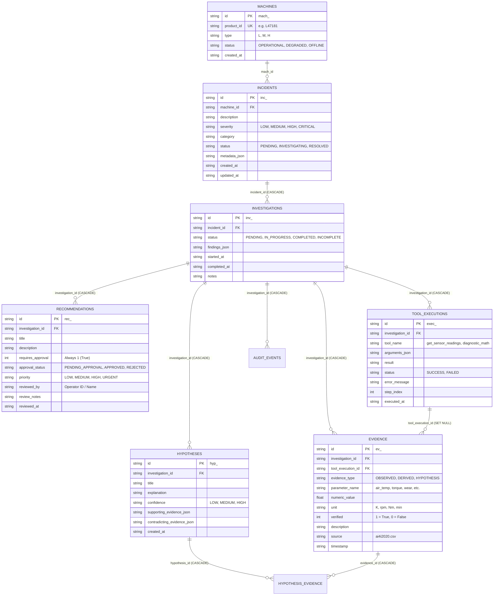

# PlantPilot — System Architecture & Data Flow

> **Status:** Stabilized & Production-Ready  
> **Last Updated:** 2026-10-26  
> **Related Documents:** [[PLANTpilot HQ]] | [[DEVELOPMENT]] | [[EXPERIMENT & TEST RESULTS]]

---

## 1. High-Level Product Architecture

PlantPilot is designed as a modular, human-supervised industrial operations AI framework with strict decoupling between the presentation layer, the application/investigation controller, the external intelligence provider, and the underlying telemetry persistence.

---

## 2. Core Subsystems & Component Responsibilities

### 2.1 Sensor Data Adapter (`backend/app/plantpilot/data_adapter.py`)
- **Primary Responsibility:** Interfaces with historical machine telemetry (`ai4i2020.csv`, 10,000 milling machine records).
- **Strict Label Quarantine:** Exposes *only* agent-facing physical measurements:
  - `air_temperature` $[K]$
  - `process_temperature` $[K]$
  - `rotational_speed` $[rpm]$
  - `torque` $[Nm]$
  - `tool_wear` $[min]$
- **Zero Label Leakage:** Completely strips ground-truth failure labels (`Machine failure`, `TWF`, `HDF`, `PWF`, `OSF`, `RNF`) from the agent. Ground-truth failure labels are exclusively accessible by `get_evaluation_only()` in the isolated evaluation engine.
- **Lookup Support:** Supports dual lookup via integer `UDI` ($1 \dots 10,000$) or string `Product ID` (e.g. `L47181`). Supports parameter aliases (e.g. `air_temp` $\to$ `air_temperature`, `rpm` $\to$ `rotational_speed`).

### 2.2 Anomaly Detection Engine (`backend/app/plantpilot/detector.py`)
- **Primary Responsibility:** Evaluates real-time or historical telemetry for multi-signal equipment stress without utilizing failure labels.
- **IQR Thresholding:** Calculates distribution quartiles ($Q1$, $Q3$, $\text{IQR} = Q3 - Q1$) across the 7,000-record training split:
  $$\text{Lower Bound} = Q1 - 1.5 \times \text{IQR}, \quad \text{Upper Bound} = Q3 + 1.5 \times \text{IQR}$$
- **Multi-Signal Anomaly Flag:** Flags an anomaly when $\ge 2$ physical parameters fall outside IQR bounds simultaneously, or when cumulative `tool_wear > 200 min` (a documented experimental heuristic).

### 2.3 AI Agent Controller (`backend/app/plantpilot/agent.py`)
- **Primary Responsibility:** Drives the bounded diagnostic investigation loop using the NVIDIA Nemotron model.
- **Bounded Investigation Loop:**
  - Maximum 8 reasoning steps and maximum 20 tool executions per incident.
  - **Step 0 Mandatory Diagnostics:** Forces `tool_choice="required"` on the initial step, ensuring the LLM cannot conclude without empirical tool execution.
  - Subsequent steps switch to `tool_choice="auto"`.
- **Evidence-First Persistence:** Telemetry returned by tools is validated and stored as `EvidenceType.OBSERVED` with `verified=True`. If no tools execute or no observations are recorded, the investigation cannot be marked `COMPLETED` and terminates as `INCOMPLETE`.
- **Fault-Tolerant Provider Handling:** Implements bounded 1-shot retry exclusively for qualifying transient upstream HTTP 500 errors.

### 2.4 Safety Policy Gatekeeper (`backend/app/plantpilot/safety.py`)
- **Primary Responsibility:** Independent, pure-Python security boundary protecting operational assets from unverified or risky LLM actions.
- **Risk Level Hierarchy:**
  - `RiskLevel.NONE` (Read-only data retrieval & statistical math — Auto-approved)
  - `RiskLevel.LOW` (Status inspection & logging — Auto-approved)
  - `RiskLevel.MEDIUM` (Diagnostic configuration adjustments — Operator approval required)
  - `RiskLevel.HIGH` (Setpoint modifications & machine recalibration — Operator approval required)
  - `RiskLevel.CRITICAL` (Emergency shutdowns, spindle halts — Operator approval required)
- **Human-in-the-Loop Enforcement:** Intercepts model-proposed recommendations and forces `requires_approval=True` and `approval_status=PENDING_APPROVAL`.

### 2.5 Storage Layer (`backend/app/plantpilot/storage.py`)
- **Primary Responsibility:** Relational SQLite persistence (`data/plantpilot.db`) with `PRAGMA foreign_keys = ON`.
- **Relational Tables:** Manages 9 tables: `machines`, `incidents`, `investigations`, `evidence`, `hypotheses`, `hypothesis_evidence`, `recommendations`, `tool_executions`, `audit_events`.
- **Cascading Deletions:** Deleting an incident cleanly cascades to all child investigations, evidence, and audit logs.
- **Dual Hypothesis-Evidence Junction:** Maintains a dedicated junction table (`hypothesis_evidence`) for granular relationships with automatic fallback to JSON fields.

### 2.6 Operator Dashboard (`frontend/app.py`)
- **Primary Responsibility:** Streamlit presentation layer connecting plant operators to the backend.
- **8 Dedicated Modules:** Operations HQ, Incident Management, AI Investigation Center, Human Sign-Off, Fleet Registry, Anomaly Detector Explorer, Evaluation Benchmarks, and System Health Diagnostics.

---

## 3. End-to-End Investigation Sequence

```mermaid
sequenceDiagram
    autonumber
    actor Operator as Plant Operator
    participant UI as Streamlit Dashboard
    participant API as FastAPI (/api/v1)
    participant Agent as AgentController
    participant Safety as SafetyPolicy
    participant Registry as ToolRegistry
    participant Adapter as DataAdapter (ai4i2020.csv)
    participant NVIDIA as NVIDIA Nemotron API
    participant DB as SQLite Storage

    Operator->>UI: Submit Incident ("Spindle overheating on Station 14")
    UI->>API: POST /api/v1/incidents
    API->>DB: Save Incident (status=PENDING)
    API-->>UI: Return Incident (inc_xxxx)

    Operator->>UI: Click "Start AI Investigation"
    UI->>API: POST /api/v1/incidents/{id}/investigations
    API->>Agent: investigate(investigation, incident)
    
    rect rgb(30, 41, 59)
        Note over Agent,NVIDIA: Step 0: Forced Diagnostic Tool Call
        Agent->>NVIDIA: chat.completions.create(tool_choice="required")
        NVIDIA-->>Agent: tool_calls: [get_sensor_readings(udi=14)]
        Agent->>Safety: check_tool_call("get_sensor_readings", args)
        Safety-->>Agent: Approved (RiskLevel.NONE)
        Agent->>Registry: execute("get_sensor_readings", args)
        Registry->>Adapter: get_sensor_readings(station_id=14)
        Adapter-->>Registry: Telemetry (air_temp, speed, torque, wear)
        Registry-->>Agent: Tool Result (JSON string)
        Agent->>DB: Save ToolExecution & Verified EvidenceItem
    end

    rect rgb(15, 23, 42)
        Note over Agent,NVIDIA: Step 1: Statistical Analysis & Hypothesis
        Agent->>NVIDIA: chat.completions.create(tool_choice="auto")
        NVIDIA-->>Agent: tool_calls: [diagnostic_math(values=[...], metric="mean")]
        Agent->>Registry: execute("diagnostic_math", args)
        Registry-->>Agent: Statistical Summary
        Agent->>DB: Save ToolExecution & EvidenceItem
    end

    rect rgb(20, 83, 45)
        Note over Agent,DB: Step 2: Synthesis & Human Gate
        Agent->>NVIDIA: chat.completions.create(tool_choice="auto")
        NVIDIA-->>Agent: Final Text: Findings + Hypotheses + Recommendations
        Agent->>Safety: check_recommendation(rec)
        Safety-->>Agent: Validated (requires_approval=True)
        Agent->>DB: Save Hypothesis, Recommendations, Audit Events
        Agent->>DB: Update Investigation (status=COMPLETED)
    end

    Agent-->>API: InvestigationResult (completed=True, steps=3)
    API-->>UI: Full Investigation Payload
    UI-->>Operator: Display Verified Evidence, Hypotheses & Action Approval Modal
```

---

## 4. Investigation Lifecycle State Machine

---

## 5. Database Schema & Relational Entity Model

---

## 6. Architectural Invariants & Guarantees

1. **Decoupled Data Source:** The core agent controller depends solely on the abstract `ToolRegistry` and `SafetyPolicy`. Swapping `ai4i2020.csv` for live OPC-UA or MQTT factory feeds requires zero changes to the LLM agent prompt or bounded loop logic.
2. **Deterministic Fallbacks:** The framework never depends on LLM reasoning for arithmetic or statistical calculation; all means, standard deviations, and IQR outlier boundaries are calculated by deterministic Python functions.
3. **No Unsupervised Actuation:** Recommendations are strictly proposals. The backend contains no automated actuation endpoint; every corrective intervention requires explicit human operator sign-off via `POST /api/v1/recommendations/{id}/review`.