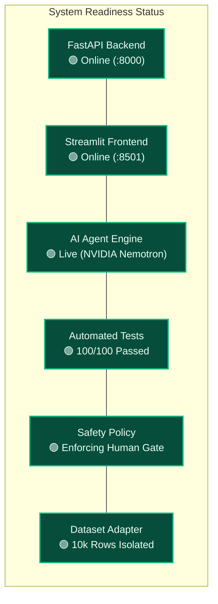
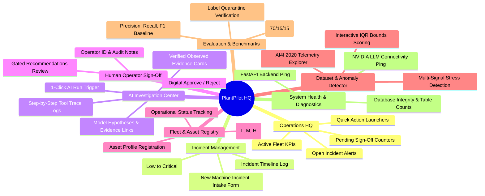
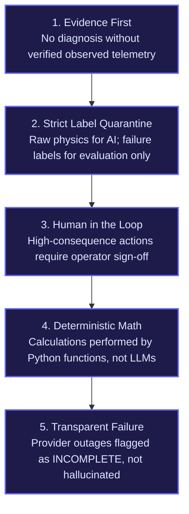

# PlantPilot / Operations HQ & Status Cockpit

> **Mission:** Build a human-supervised, evidence-first industrial operations AI copilot that investigates equipment anomalies, presents verified empirical findings, and recommends human-gated actions for plant reliability.

---

## 1. Executive Operations Cockpit

### System Health & Readiness Metrics

| Component | Status | Metric / Evidence | Production Verification |
|:---|:---:|:---|:---|
| **FastAPI Backend** | 🟢 **STABLE** | HTTP 200 on `/health`, sub-50ms REST dispatch | `backend/app/plantpilot/main.py` |
| **Streamlit Dashboard** | 🟢 **STABLE** | 8 modular operational views running on port 8501 | `frontend/app.py` |
| **Investigation Loop** | 🟢 **ACTIVE** | Bounded max 8 steps, Step 0 forced diagnostic call | `backend/app/plantpilot/agent.py` |
| **Safety Policy** | 🟢 **ACTIVE** | 100% human sign-off required on recommendations | `backend/app/plantpilot/safety.py` |
| **Telemetry Adapter** | 🟢 **VERIFIED** | 10,000 records loaded, zero label leakage | `backend/app/plantpilot/data_adapter.py` |
| **Automated Test Suite** | 🟢 **100% PASS** | 100 passed tests in 4.69 seconds | `backend/tests/` |
| **Evaluation Baseline** | 🟢 **BENCHMARKED** | Stratified split (`seed=42`), Baseline F1 = 0.177 | `backend/app/plantpilot/eval/` |

---

## 2. Operator Dashboard Navigation Hierarchy

---

## 3. Development Roadmap & Completion Checklist

- [x] **FastAPI Core Foundation**
  - [x] Decoupled backend architecture in `backend/`
  - [x] SQLite relational storage with `PRAGMA foreign_keys = ON`
  - [x] Incident registration and pagination endpoints (`/api/v1/incidents`)
  - [x] Investigation trigger and retrieval endpoints (`/api/v1/investigations`)
  - [x] Machine fleet asset management endpoints (`/api/v1/machines`)
  - [x] Human recommendation sign-off endpoint (`/api/v1/recommendations/{id}/review`)

- [x] **Evidence-First AI Agent & Safety**
  - [x] NVIDIA Nemotron-3.5-super-vl-120b integration via OpenAI SDK
  - [x] Step 0 forced diagnostic tool call (`tool_choice="required"`)
  - [x] Schema-validated tool registry with input sanitation (`ToolRegistry.validate_arguments`)
  - [x] Python safety gatekeeper with 5-tier risk grading (`safety.py`)
  - [x] Strict human-in-the-loop requirement (`requires_approval=True`)
  - [x] Bounded retry for transient upstream 500 provider errors

- [x] **Sensor Data & Evaluation Engine**
  - [x] AI4I 2020 predictive maintenance CSV adapter (`10,000` records)
  - [x] Complete label quarantine isolating failure labels from the agent
  - [x] Reproducible stratified dataset split (`seed=42`, 70% train / 15% dev / 15% eval)
  - [x] Deterministic baseline benchmark metrics (`F1 = 0.177`)

- [x] **Streamlit Operator Presentation Layer**
  - [x] Dark-mode industrial interface with custom CSS styling (`styles.css`)
  - [x] Live backend connectivity pill indicator
  - [x] 8 dedicated operational views covering operations, investigations, approvals, telemetry, and evaluation

- [x] **Quality Assurance & Verification**
  - [x] 100 automated pytest cases across unit, schema, safety, storage, and E2E integration suites
  - [x] Zero-leakage label tests validating physical telemetry isolation
  - [x] Comprehensive documentation knowledge base in `docs/` and root `GEMINI.md`

---

## 4. Core Operating Principles

---

## 5. Knowledge Base Cross-References

- **System Architecture & Detailed Data Flows:** [[ARCHITECTURE]]
- **Chronological Engineering Logs & Milestones:** [[DEVELOPMENT]]
- **Scientific Experiments & Benchmark Evaluation:** [[EXPERIMENT & TEST RESULTS]]
- **Complete AI Pair-Programming Specification:** [GEMINI.md](file:///c:/Warning/hackathon/PlantPilot/GEMINI.md)